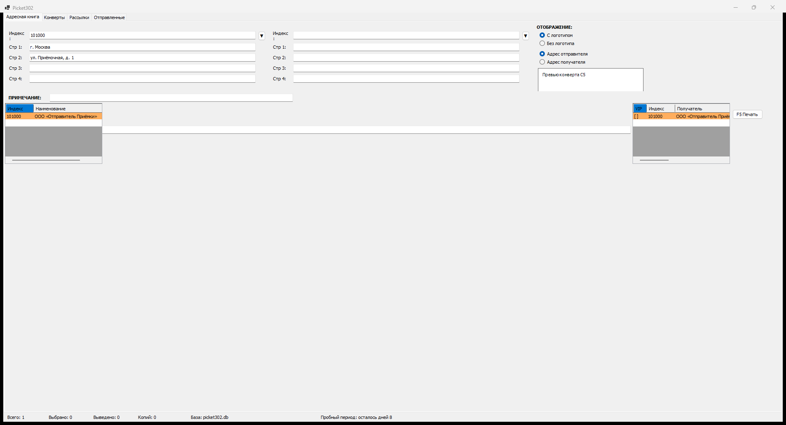
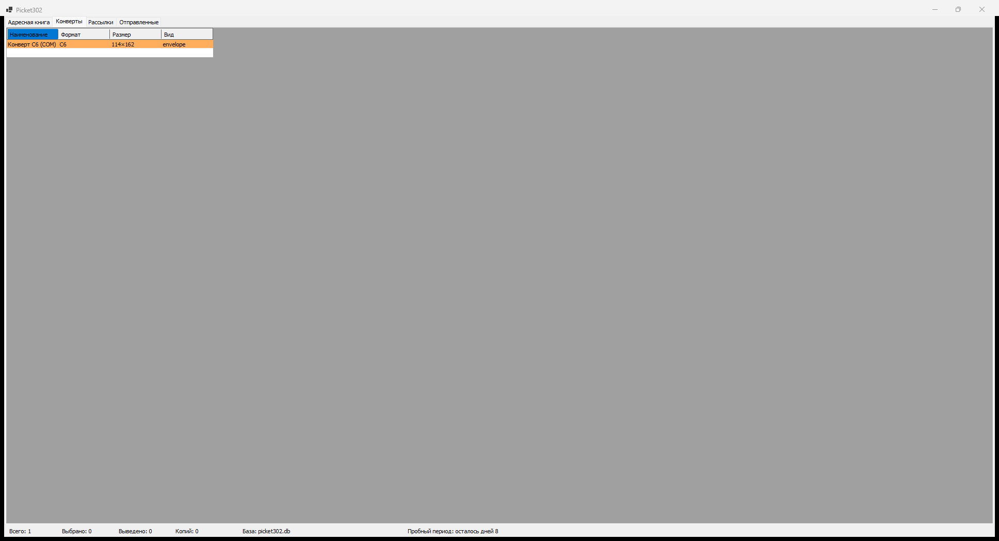
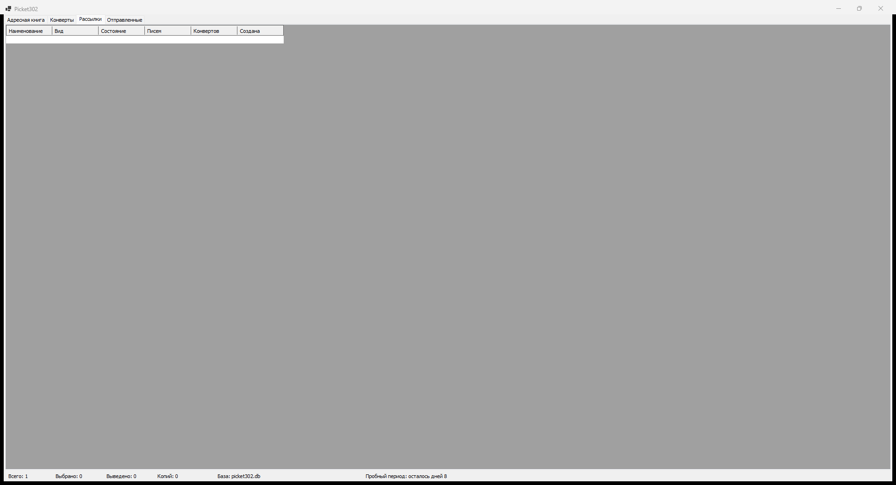
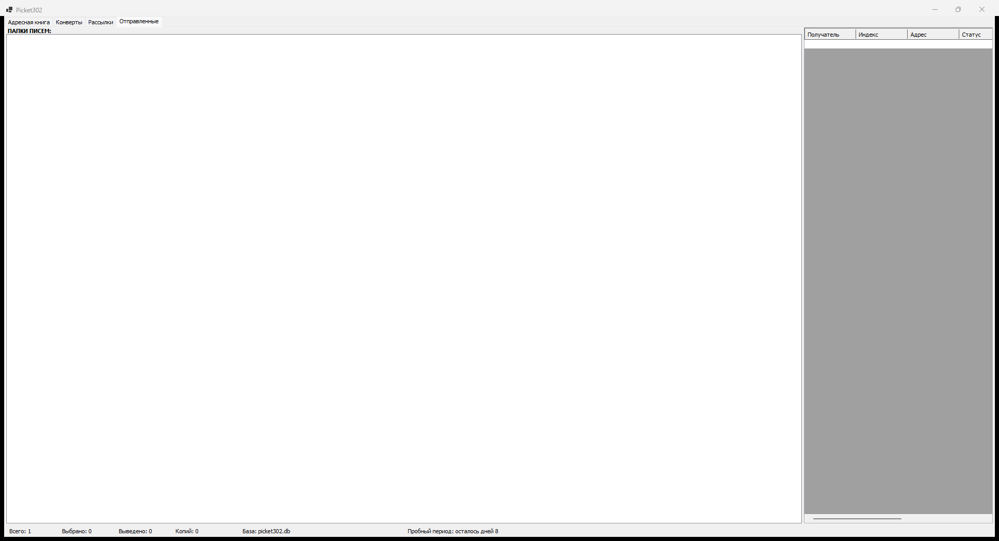
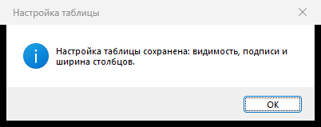

# UX/UI-аудит Picket302 — 2026-11-03

Аудит проведён со стороны пользователя: приложение запущено (Release-сборка), пройдены все
четыре вкладки, ключевые действия и диалоги; каждый экран снят скриншотом, элементы
проинвентаризированы через UI Automation, дополнено чтением UI-кода.
Скриншоты: `docs/ux-audit-2026-11-03/*.png`.

---

## 1. Главный вывод

Приложение **функционально, но интерфейс не собран**: контролы свалены в углы экрана,
80 % площади — пустое серое поле, а главное — **главное меню приложения невидимо**, из-за
чего подавляющее большинство функций (импорт из 1С, фильтры, архивирование, интеграции,
диагностика, регистрация, справка — около 45 команд) пользователь не может найти в
принципе. Жалоба «найти не могу» подтверждается буквально.

Это не «косметика», а три уровня проблем:

| Уровень | Суть |
|---|---|
| **Дефекты видимости (P0)** | Функции существуют, но не видны или не достижимы: невидимое меню, экраны без кнопок действий |
| **Компоновка (P1)** | Контролы прижаты к углам, нет сетки, группировки и иерархии; серые «мёртвые зоны» |
| **Стиль (P2)** | Дефолтный WinForms: Tahoma 8pt, серый фон, капслок-заголовки, кнопки на английском, эмодзи-иконки |

---

## 2. Критические находки (P0 — исправить немедленно)

### U1. Главное меню приложения невидимо — все функции недостижимы
- **Факт:** меню строится (`ПостроитьМеню()`, MainShell.cs:599–706 — Файл, Правка, Вид,
  Данные, Сервис, Печать, Рассылки, Справка) и регистрируется (`MainMenuStrip = _меню`,
  MainShell.cs:202), но **не добавляется в Controls формы** (MainShell.cs:200–203:
  `Controls.Add(_вкладки)`, `Controls.Add(_строкаСостояния)` — `_меню` отсутствует).
  Дополнительно `_меню.Dock = DockStyle.None` (MainShell.cs:601) лишает его стандартного
  положения сверху.
- **Следствие:** ни одна из ~45 команд меню не видна: импорт/экспорт, 1С, фильтры,
  архивирование, «Новая рассылка…», настройки интеграции (COM), подключение к базе,
  диагностика, калькулятор, язык, регистрация, справка — всё недостижимо мышью.
- **Это также отклонение от ТЗ §7.1** («меню: Файл Правка Вид Сервис Печать Рассылки Справка»).
- **Исправление:** `Controls.Add(_меню)` перед `_вкладки`, вернуть `Dock = DockStyle.Top`
  (или просто не переопределять Dock — у MenuStrip он Top по умолчанию).

### U2. Экраны «Конверты» и «Рассылки» без единого действия
- Вкладка «Конверты»: одна строка форматов в левом верхнем углу и серое поле на весь экран.
  Ни кнопки «Добавить бланк», ни «Печать», ни подсказки.
- Вкладка «Рассылки»: пустая таблица (Наименование/Вид/Состояние/Писем/Конвертов/Создана)
  в углу. Создать рассылку с экрана **невозможно** — команда «Новая рассылка…» существует
  только в невидимом меню (MainShell.cs:684).
- **Следствие:** два из четырёх разделов программы выглядят «сломанными» и не дают начать работу.

### U3. Молчаливые операции без обратной связи
- F6 «Превью» при отсутствии выбранных получателей **ничего не делает и ничего не
  сообщает** («Выбрано: 0» виден только мелким текстом в статус-баре). Проверено
  фактически: нажатие не открывает ни окна, ни сообщения.
- Кнопка «⚙» не открывает настройки: она **молча сохраняет** конфигурацию таблицы и
  показывает сообщение «Настройка таблицы сохранена…» (проверено фактически). Иконка-эмодзи
  без подписи не сообщает пользователю ни действие, ни результат.

### U4. Кнопки и подписи на английском в русском интерфейсе
- Кнопки гридов: **«+», «Edit», «Del»** (два блока на главном экране). Остальной интерфейс —
  русский. ТЗ требует русский интерфейс.

---

## 3. Экранные находки

### 3.1 Вкладка «Адресная книга» (главный экран) — 

Что видит пользователь: три независимых списка («Быстрый выбор», «СПРАВОЧНИК
ОТПРАВИТЕЛЕЙ», реестр получателей), два блока полей адреса (ОТПРАВИТЕЛЬ/ПОЛУЧАТЕЛЬ по
«Индекс + Стр 1…6»), панель «ОТОБРАЖЕНИЕ» с четырьмя радио, поле «ПРИМЕЧАНИЕ», кнопки
F5/F6/Excel/⚙. Всё прижато к верхней кромке; ниже — серая пустота на ~70 % высоты.

| # | Приоритет | Проблема |
|---|---|---|
| A1 | P1 | Нет структуры: три списка + две формы редактирования на одном экране без визуального разделения. Зонирование читается только по капслок-подписям |
| A2 | P1 | ~70 % экрана — пустое серое поле; списки высотой 3–4 строки при 1080p |
| A3 | P1 | Подписи «Стр 1…Стр 6» ничего не говорят пользователю (адресные строки, но это надо знать из ТЗ) |
| A4 | P2 | «ОТОБРАЖЕНИЕ:» — четыре радио в одном флоу, хотя это две разные пары (логотип да/нет; чей адрес). Радио «основной» у отправителя/получателя без пояснения |
| A5 | P2 | Заголовки капслоком («СПРАВОЧНИК ОТПРАВИТЕЛЕЙ:») с двоеточиями — шум, не иерархия |
| A6 | P2 | Кнопки F5/F6/F7 — хоткеи в подписях; для новичка неочевидно, что F7 существует только в невидимом меню |
| A7 | P3 | «Быстрый выбор» и «СПРАВОЧНИК ОТПРАВИТЕЛЕЙ» дублируют по смыслу выбор записи; различие не объяснено |

### 3.2 Вкладка «Конверты» — 

| # | Приоритет | Проблема |
|---|---|---|
| B1 | P0 | Нет действий: добавить/редактировать бланк, печать — только через невидимое меню |
| B2 | P1 | Таблица бланков ~430 px в углу; остальное — серое поле |
| B3 | — | *Уточнение при повторной проверке:* таблица форматов бланков на вкладке видима (строка «Конверт С6 (COM)» на скриншоте); «скрытый грид» в обходе UIA — тот же список бланков, реальной скрытости нет |

### 3.3 Вкладка «Рассылки» — 

| # | Приоритет | Проблема |
|---|---|---|
| C1 | P0 | Нет «Новая рассылка…», «Повторная отправка», «Объединить» на экране — всё в невидимом меню |
| C2 | P1 | Пустая таблица без empty-state (подсказка «Создайте рассылку кнопкой …») |
| C3 | P2 | Таблица ~610 px в левом углу, серый фон остального экрана |

### 3.4 Вкладка «Отправленные» — 

| # | Приоритет | Проблема |
|---|---|---|
| D1 | P1 | «ПАПКИ ПИСЕМ:» — пустое белое дерево без единого узла и пояснений (папки создаются где-то ещё) |
| D2 | P2 | Реестр справа (Получатель/Индекс/Адрес/Статус) без empty-state |
| D3 | P2 | Громоздкий горизонтальный скроллбар под деревом при пустом дереве |

### 3.5 Диалог «Настройка таблицы» — 

| # | Приоритет | Проблема |
|---|---|---|
| E1 | P0 | Вызывается кнопкой «⚙», но это не настройка, а слепое сохранение (см. U3) |
| E2 | P3 | Сам диалог — системный MessageBox с ОК: допустимо, но текст не говорит, ЧТО сохранено и для какой таблицы |

### 3.6 Статус-бар (все экраны)

| # | Приоритет | Проблема |
|---|---|---|
| F1 | P2 | «Всего: 1 Выбрано: 0 Выведено: 0 Копий: 0» — телеграфный стиль, нет разделителей/иконок; «Копий» без контекста |
| F2 | P2 | «Пробный период: осталось дней 8» — текстом в общем ряду; важная информация затеряна (см. также FormLicenseNag) |
| F3 | P3 | «База: picket302.db» полезно, но без пути; при проблемах подключения не видно, к чему подключены |

---

## 4. Системные (кодовые) причины

| # | Факт | Объём | Последствие |
|---|---|---|---|
| G1 | Жёсткий шрифт `"Tahoma" 8f` по всему UI | **82 места** (MainShell — 18, AddressEditor — 5, FormDistributionEditor — 4, …) против 4 упоминаний Segoe UI | Устаревший вид, мелкий кегль, рваная типографика; правка шрифта = правка 82 строк |
| G2 | Фиксированные координаты `Location = new Point(...)` | **198 мест** против 21 `Anchor` и 87 `Dock` | Экран не адаптируется к размеру окна/DPI: на маленьком окне (как у пользователя) контролы обрезаются, на большом — пустота |
| G3 | Дефолтные цвета (серый `Control`) | — | «Мёртвые зоны», нет фирменного вида |
| G4 | Нет единого рендерера/стиля ToolStrip, гридов | — | Каждый контрол выглядит по-своему |
| G5 | Нет empty-states | — | Пустые экраны выглядят как поломка |
| G6 | Иконки-эмодзи в кнопках («⚙», «▼») | — | Непрофессиональный вид, шрифтозависимость |

---

## 5. Целевая дизайн-система (предложение)

Подобрана под тип продукта «рабочий инструмент оператора» (стиль Data-Dense Dashboard,
ui-ux-pro-max; палитра скорректирована под десктоп WinForms и системные шрифты):

**Типографика**
- Базовый шрифт: `Segoe UI 9pt` (системный для Windows, отличная кириллица).
- Заголовки групп/карточек: `Segoe UI 9pt SemiBold`, обычный регистр («Справочник
  отправителей» вместо капслока).
- Мелкий вторичный текст (подсказки, статус-бар): `Segoe UI 8pt`, цвет `#475569`.

**Палитра (токены)**

| Токен | Значение | Применение |
|---|---|---|
| Primary | `#1E40AF` | Кнопки главных действий, активная вкладка, выделение строки |
| On Primary | `#FFFFFF` | Текст на primary |
| Accent | `#D97706` | Акцент: предупреждения, VIP-строки, счётчики |
| Background | `#F8FAFC` | Фон окон/вкладок (вместо серого `Control`) |
| Card | `#FFFFFF` | Панели/карточки групп |
| Border | `#DBEAFE` | Рамки карточек, линии разделения |
| Muted text | `#475569` | Вторичный текст |
| Danger | `#DC2626` | Удаление, ошибки |
| Success | `#15803D` | Успешные статусы отправки |

**Геометрия**
- Сетка отступов 8 px: паддинг карточек 12–16 px, межблочные 12 px, между подписью и
  полем 4 px.
- Компоновка: `TableLayoutPanel`/`SplitContainer` вместо фиксированных точек; гриды —
  `Dock = Fill` внутри своей зоны; минимум экрана 1280×720 без обрезок.

**Контролы**
- Кнопки: Primary (одна на экран: «Печать», «Создать рассылку»), стандартные (вторичные),
  в гридах — кнопки с русскими подписями «Добавить / Изменить / Удалить» (или иконки с
  тултипами на русском).
- Empty-state для каждого списка: иконка + одна строка «здесь появятся X» + кнопка
  первого действия.
- Статус-бар: `Всего: N · Выбрано: M · Выведено: K` с разделителями; пробный период —
  отдельной секцией с цветом по остатку дней.
- Иконки: монохромные SVG-наборы (перекладываются в PNG/шрифт Segoe Fluent Icons —
  встроен в Windows 11, на Win10 — Segoe MDL2 Assets), без эмодзи.

---

## 6. План работ (по этапам, от дешёвого к системному)

### Этап 0 — «Вернуть управление» (P0, ~0,5–1 день)
1. Показать меню: `Controls.Add(_меню)` + Dock Top (U1).
2. Кнопки гридов: «Добавить/Изменить/Удалить» на русском (U4).
3. Кнопку «⚙» заменить на «Настройка таблицы…», открыть форму настройки, а не слепое
   сохранение (U3/E1).
4. F6/F7 без выделения — понятное сообщение «Выберите получателей» (U3).
5. На «Конверты» и «Рассылки» добавить панели инструментов с действиями: «Добавить
   бланк…», «Печать бланка…», «Новая рассылка…», «Повторная отправка…» (U2/B1/C1).

### Этап 1 — «Единый стиль» (P1–P2, 1–2 дня)
1. Базовый шрифт: задать `Font` у `MainShell` и всех форм один раз (потом убрать 82
   локальных Tahoma постепенно: наследование Font уже даст эффект).
2. Токены цветов: один статический класс `UiPalette`; фон окон `#F8FAFC`, карточки белые
   с рамкой `#DBEAFE`.
3. Статус-бар: переразбить секции, разделители, цветовая индикация пробного периода.
4. Empty-states для 4 списков.

### Этап 2 — «Компоновка главного экрана» (P1, 3–5 дней)
1. «Адресная книга»: SplitContainer — слева список получателей (главная таблица, Dock
   Fill), справа карточка редактирования (отправитель/получатель/примечание) с
   группировкой по карточкам; «Быстрый выбор» и «Справочник отправителей» — выпадающие
   панели или вторая колонка.
2. Переход с `Location = new Point` на TableLayoutPanel/Dock в главных экранах
   (приоритет: MainShell, AddressEditor, FormDistributionEditor).
3. «Конверты»/«Рассылки»/«Отправленные»: таблица на весь экран + панель инструментов
   сверху.

### Этап 3 — «Полировка» (P2–P3, по остаточному принципу)
1. Иконки Fluent, тултипы на русском, заголовки групп SemiBold.
2. Формы адреса: подписи «Стр 1…6» → «Индекс», «Улица и дом», «Город» и т.п. по ТЗ §,
   либо подпись-подсказка (placeholder-строка под полем).
3. Радиогруппа «ОТОБРАЖЕНИЕ» → две чёткие группы («Логотип»: с логотипом/без;
   «Адрес»: отправителя/получателя) с пояснением.
4. F1-справка, подсказки при первом запуске (FormFirstRun уже есть — обновить текст под
   новую компоновку).

---

## 7. Что этот аудит НЕ делает

- Не меняет функциональность и не трогает логику — все находки касаются видимости,
  компоновки и стиля.
- Не предлагает смену фреймворка (WPF/WinUI) — редизайн выполним средствами WinForms
  (этапы 0–2 это подтверждают).
- Не исправляет найденное: правки — отдельной задачей по этапам после вашего
  подтверждения.

---

## 8. Приложение: методика аудита

1. Release-сборка (`dotnet build -c Release`, 0 ошибок/предупреждений), запуск exe.
2. Обход: вкладки переключались программно (TCM_SETCURFOCUS), элементы инвентаризированы
   UI Automation (полные списки контролов по каждой вкладке), диалоги открывались и
   снимались (PrintWindow), проверены фактические реакции кнопок (⚙, F6).
3. Код: MainShell.cs (меню, вкладки, статус-бар), AddressEditor, список 39 форм в
   `src/Picket302.App/UI/Forms/`, количественные метрики (шрифты, координаты, якоря).
4. Реальная печать и отправка SMTP в ходе аудита не выполнялись.
